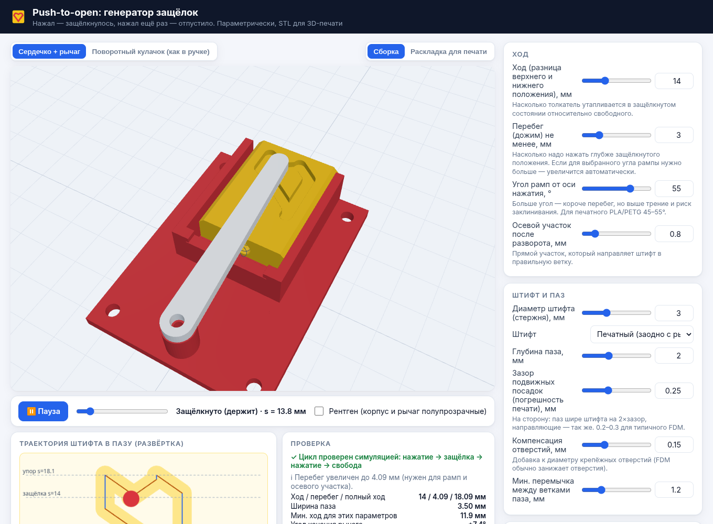
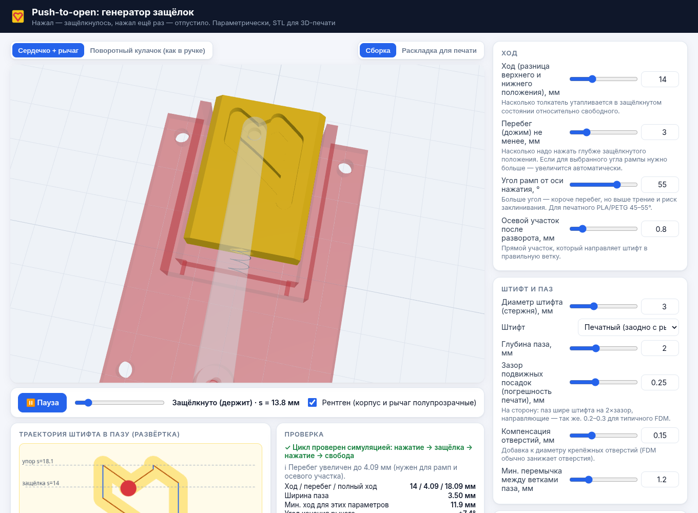
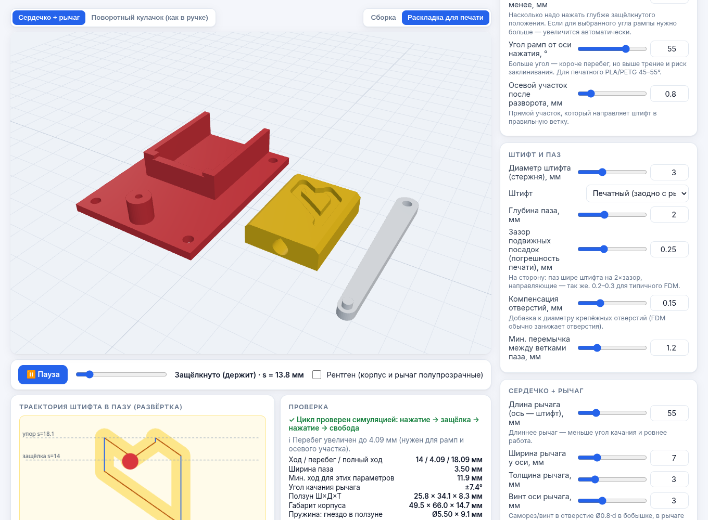
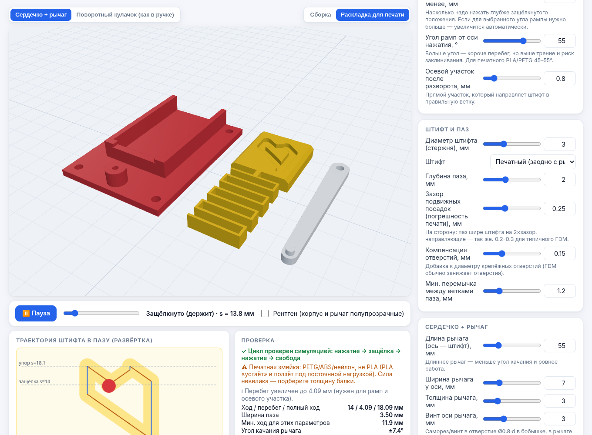
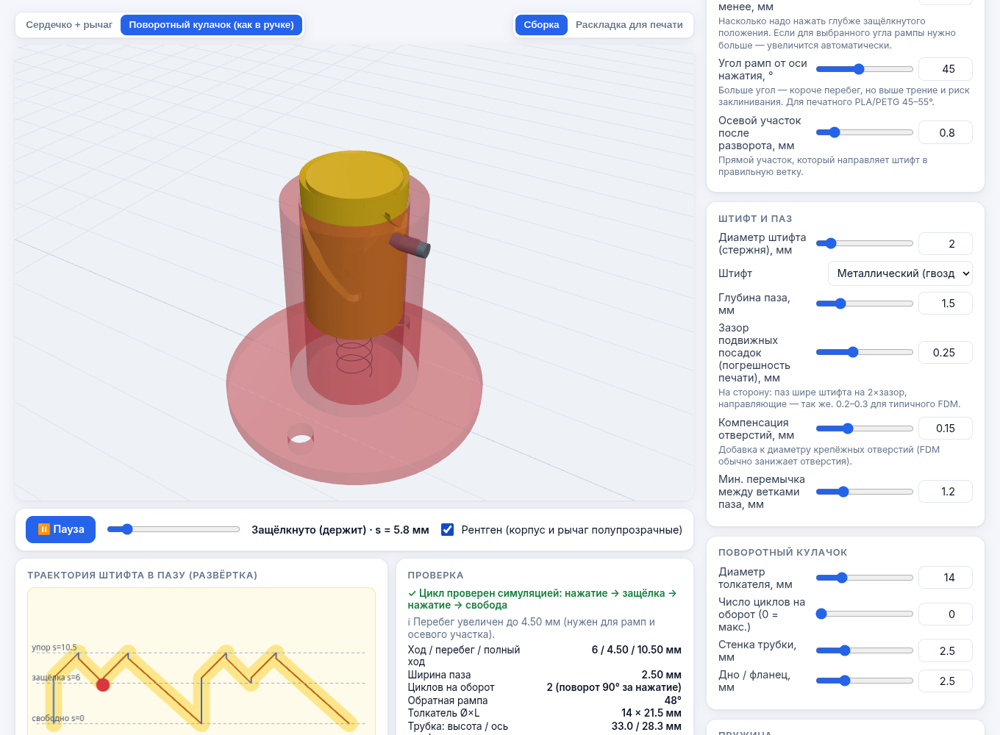
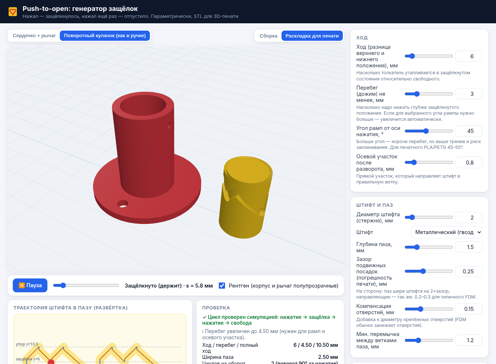
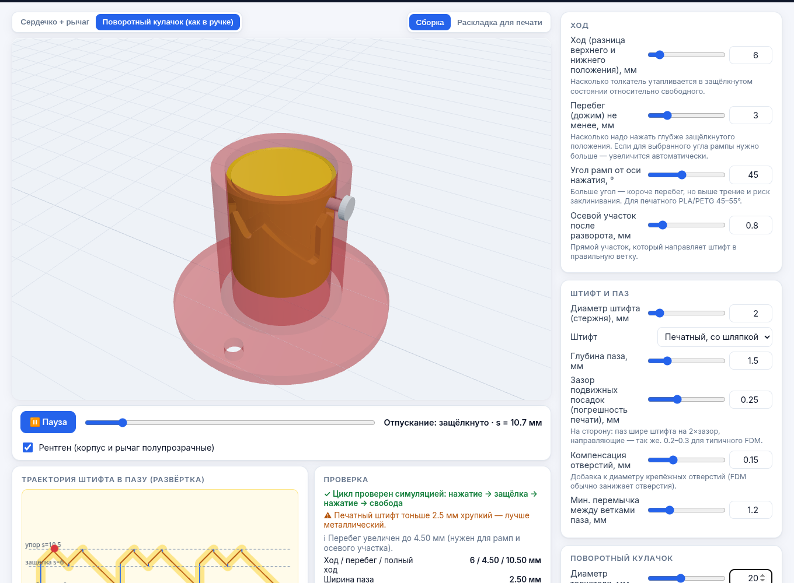

# Push-to-open: генератор защёлок для 3D-печати

Параметрический генератор механизмов **push-push** (push-to-open, «нажал — защёлкнулось, нажал ещё раз — отпустило») прямо в браузере. Живой 3D-просмотр с анимацией цикла, развёртка траектории штифта, проверка геометрии симуляцией, STL каждой детали в положении для печати и zip со всеми деталями. Интерфейс на русском.

## Запуск
- **Сайт (GitHub Pages):** после загрузки в репозиторий включите *Settings → Pages → Source: GitHub Actions*. Workflow `.github/workflows/pages.yml` соберёт и опубликует сайт при каждом пуше в `main`.
- **Windows, локально:** дважды щёлкните `run.bat`. Он поднимет `python -m http.server 8765` в папке `dist` и откроет http://127.0.0.1:8765/. Нужен Python 3.
- **Из исходников:** `npm install`, затем `npm run dev` (разработка) или `npm run build`.

## Какие бывают механизмы push-push
| Вариант | Как работает | Детали | Ход / перебег | Плюсы | Минусы для FDM |
|---|---|---|---|---|---|
| **Сердечко + качающийся рычаг** (как на фото) — *реализован* | Ползун с замкнутым пазом-«сердечком», штифт на конце рычага, рычаг качается на винте | корпус, ползун, рычаг, пружина, винт | ход 10–25 мм, перебег 3–5 мм | Наглядно, легко отлаживать, всё печатается плоско, без поддержек | Минимальный ход ограничен шириной сердечка; корпус крупный |
| Сердечко + проволочный штифт | То же сердечко, но вместо рычага — изогнутая проволока (скрепка, Ø0.8–1.2), которая прижимает конец в паз | ползун, корпус, проволока, пружина | ход от ~6 мм | Очень компактно, так сделаны мебельные защёлки и толкатели SD-карт | Нужна гнутая проволока; паз мелкий, требует точной печати |
| **Поворотный кулачок, как в шариковой ручке** — *реализован* (вариант с цилиндрическим пазом) | Толкатель свободно вращается в трубке, по пилообразному замкнутому пазу на нём ходит неподвижный радиальный штифт | трубка, толкатель, штифт (гвоздь/пруток), пружина | ход от ~3 мм, перебег 4–6 мм | Компактно, малый ход, осевая форма, толкатель удерживается самим штифтом | Паз на цилиндре печатается стоя, с небольшими нависаниями |
| Классическая ручка: зубчатая коронка + ротор | Кнопка с пилой толкает ротор, ротор проворачивается по рёбрам корпуса и встаёт на короткие или длинные пазы | корпус с рёбрами, кнопка, ротор, пружина | ход 2–4 мм | Самый короткий ход | Мелкие зубья 0.5–1 мм на пределе FDM, детали собираются внутри трубки |
| Защёлка-«собачка» (поворотный крючок) | Нажатие поворачивает подпружиненный крючок, второе нажатие сбрасывает | 3–4 детали, 2 пружины | — | Держит большие нагрузки | Сложнее, две пружины, а логику push-push обеспечивает тот же кулачок |
| Магнитный push-to-open | Толкатель + магнит + механизм сердечка внутри | покупное изделие | — | Готовое решение | Внутри то же сердечко |

Генератор строит два самых практичных для печати варианта: **сердечко с рычагом** (как на фото) и **поворотный кулачок**.

## Как обеспечена однозначность цикла
Траектория строится по правилу: **после каждой смены направления нужная ветка паза начинается прямым участком вдоль оси нажатия** (синий на развёртке), а неправильная наклонена на угол рампы. Рычаг и толкатель свободны в боковом направлении, поэтому без бокового усилия штифт идёт прямо и всегда попадает в нужную ветку. Повороты делают только наклонные стенки (коричневый на развёртке). Ступеньки по глубине паза и подпружиненный штифт не нужны.

Каждый набор параметров проверяется **квазистатической симуляцией**: штифт с зазором проходит цикл «нажатие → защёлка → нажатие → свобода». Если цикл не замыкается, генератор показывает ошибку. Тесты дополнительно проверяют, что детали не пересекаются на всём цикле, и что все STL замкнуты (watertight).

## Параметры
- **Ход** (разница верхнего и нижнего положения). **Перебег** (дожим ниже защёлки): если для выбранного угла рампы перебега не хватает, он увеличивается автоматически. **Угол рамп** от оси нажатия. **Осевой участок** после разворота.
- **Диаметр штифта**, штифт печатный или металлический, **глубина паза**, **зазор подвижных посадок** (погрешность печати, на сторону), **компенсация отверстий**, **минимальная перемычка** между ветками.
- **Сердечко:** длина, ширина и толщина рычага, винт оси, толщина ползуна, основание, стенка и губа направляющих (фаска 45°).
- **Кулачок:** диаметр толкателя, число циклов на оборот (0 = максимум), стенка трубки, дно и фланец.
- **Пружина:** металлическая (наружный диаметр, свободная длина, длина сжатой до упора, предварительное сжатие) или печатная змейка заодно с ползуном (только для сердечка; число витков, толщина балки).
- **Монтаж:** диаметр крепёжных отверстий, вылет толкателя в защёлкнутом положении.

Генератор проверяет: минимальный ход сердечка, угол качания рычага, хватает ли длины пружины на полный ход и на длину сжатой до упора, длину рычага, крутизну обратной рампы, нависания паза, глубину паза, отверстие штифта.

## Печать и сборка
- **Без поддержек.** Корпус и ползун печатаются основанием на стол: губы направляющих сделаны под 45°, гнездо пружины в форме капли. Рычаг кладётся верхней стороной на стол, штифтом вверх. Трубка печатается фланцем вниз, толкатель стоя.
- **Зазор:** 0.2–0.25 мм для откалиброванного принтера, 0.3–0.35 мм, если подвижные детали заедают. Сначала напечатайте один ползун или толкатель и проверьте цикл.
- **Пружины.** Сердечко: пружина сжатия Ø5×30 мм, проволока 0.5 мм (из набора). Кулачок: Ø6×25 мм. Введите свои размеры, генератор подстроит гнездо и проверит ход. Печатную змейку печатайте из PETG/ABS/нейлона, не из PLA.
- **Штифт.** Печатный штифт тоньше 2.5 мм хрупкий. Лучше стальной пруток, гвоздь или хвостовик сверла, запрессованный в отверстие.
- **Смазка:** паз смазывается графитом или сухой PTFE-смазкой.

## Скриншоты
| | |
|---|---|
|  Сердечко, рентген, защёлкнуто |  Раскладка для печати |
|  Печатная пружина-змейка |  Поворотный кулачок |
|  Кулачок: раскладка |  Ø20 мм, 3 цикла на оборот |

## Разработка
- `npm test`: строит 8 наборов параметров, пишет STL в `test-output`, проверяет детали на пересечения по циклу.
- `python3 tests/check_stl.py test-output`: проверяет, что STL замкнуты (нужен trimesh).
- `npm run build && npx vite preview --port 4174`, затем `npm run e2e`: Playwright, скриншоты, скачивание STL и zip.

Стек: Vite, three.js, [manifold-3d](https://github.com/elalish/manifold), fflate. Лицензия MIT.
